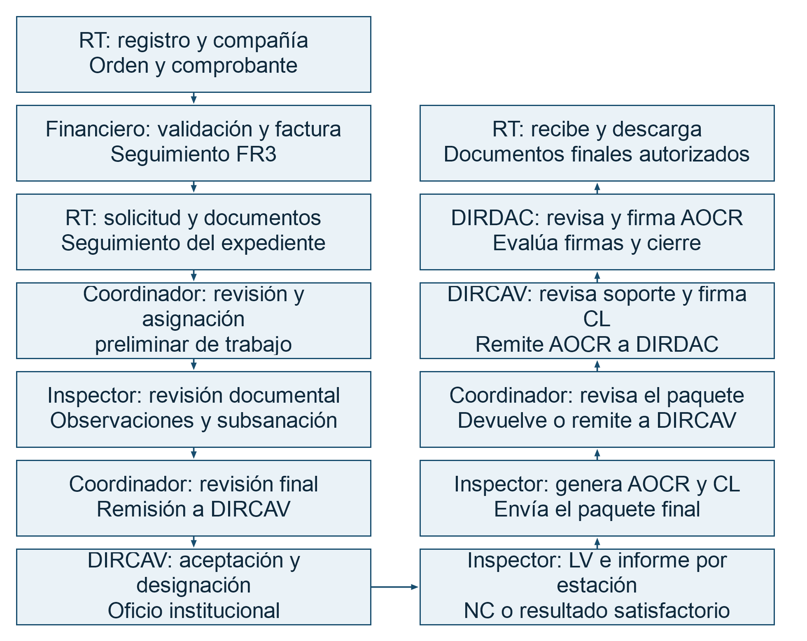
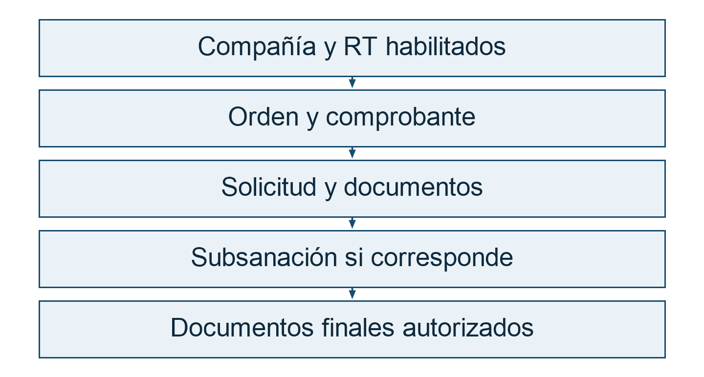
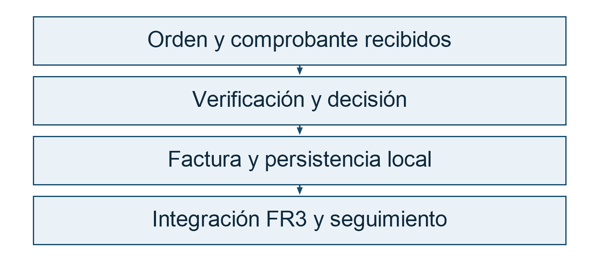
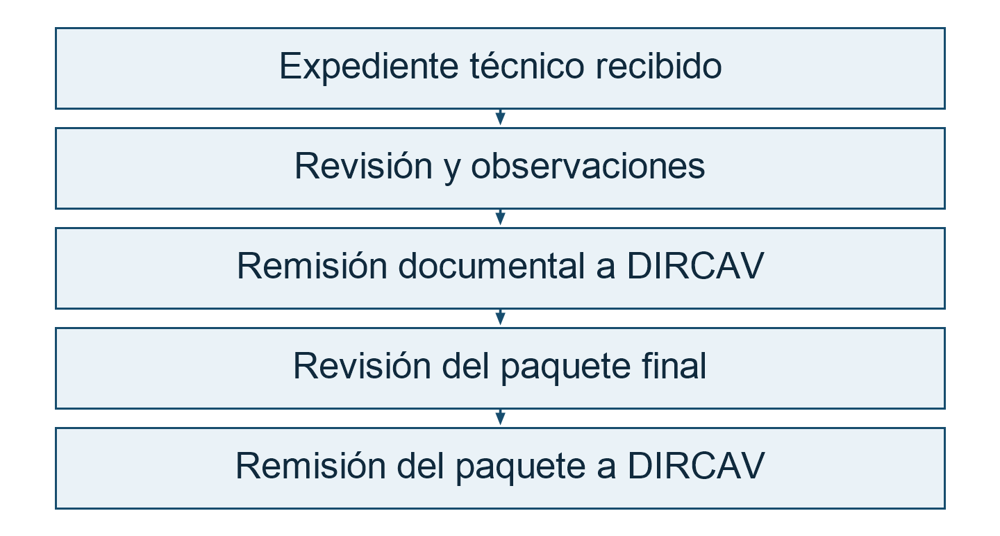
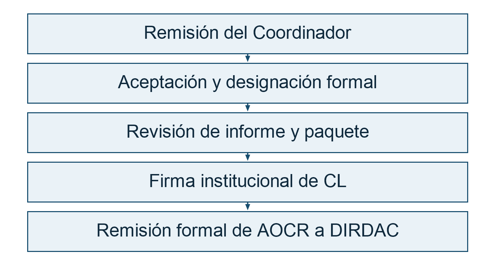
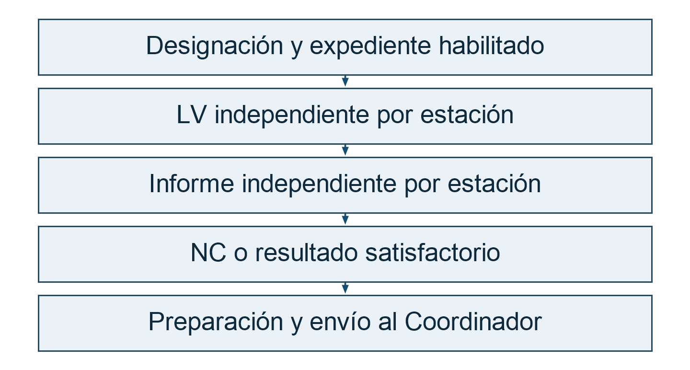
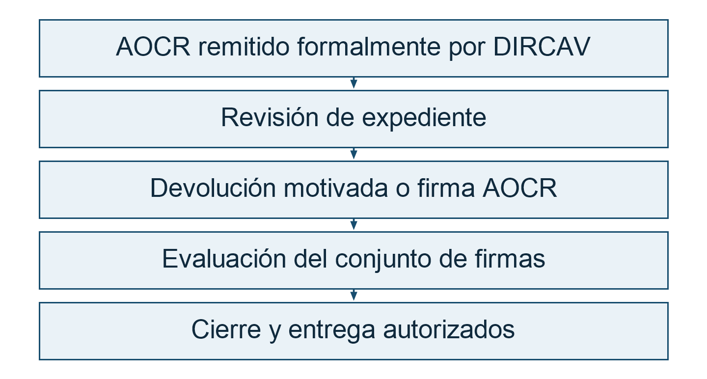
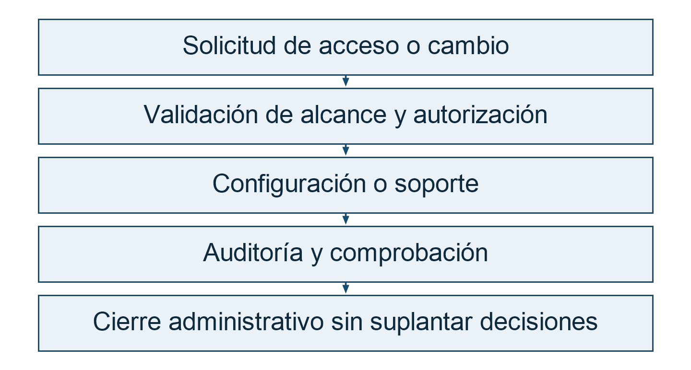
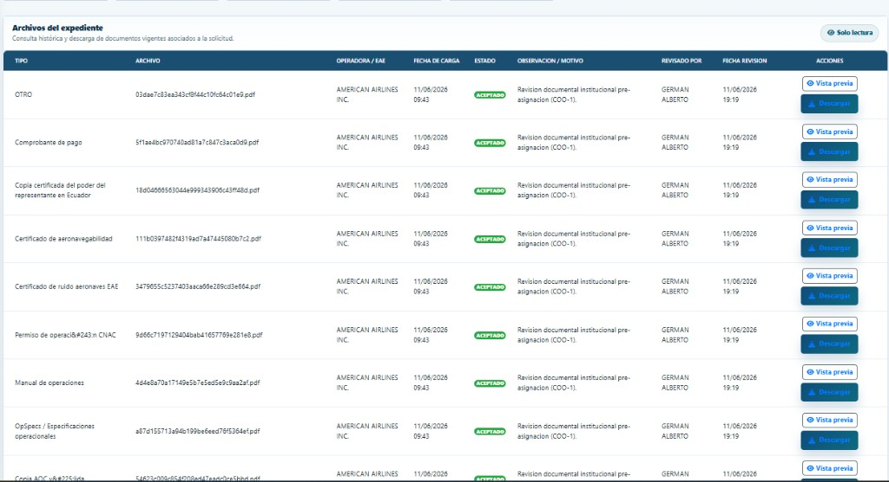

# Uso y alcance del manual

Este manual permite seguir el trámite AOCR por rol, desde el registro del RT y el componente económico hasta la revisión, inspección, firmas y descarga. Describe la versión confirmada por el usuario y distingue el flujo implementado de las funciones parciales y de las validaciones institucionales que todavía no se han acreditado. No autoriza al usuario a suplir decisiones de otro rol.

La rama de referencia es **fix/cierre-flujo-aocr**, commit **6d885a984bb875507366a824a290681450376d87**, con corte documental al **03/11/2026**. El diccionario de datos corresponde a una consulta de solo lectura de la base configurada, confirmada por el usuario para esta revisión. No se garantiza que toda migración de ese commit esté aplicada en cada servidor.

## Cómo encontrar un procedimiento

Use el índice de Word o PDF para ir a su rol y después al código P01 a P29. Cada procedimiento indica qué debe existir antes de actuar, los datos, pasos, resultado, avisos y corrección de errores. Cada lista de pasos vuelve a comenzar en 1. Las rutas se muestran únicamente como referencia para localizar una pantalla real; no reemplazan el ingreso autenticado ni conceden permisos.

## Qué significan los estados de implementación

| Clasificación | Significado |
| --- | --- |
| Implementado | Existe código contrastado en el corte. La prueba de una operación real se identifica por separado. |
| Parcial | Existe código pero hay una contradicción, dependencia o circuito heredado que impide acreditar todo el procedimiento. |
| Pendiente | Requisito o validación institucional que no está terminado o no se ha acreditado. |
| No localizado | No se encontró la evidencia en el ámbito revisado. No implica que no exista en otra infraestructura. |

## Condiciones de trabajo

Use una cuenta personal autorizada, verifique rol y compañía antes de actuar y no comparta certificados o contraseñas. Prepare documentos legibles y conserve el número del trámite. Cuando una decisión falle, compruebe el estado antes de repetirla. Un mensaje transitorio, una notificación o un PDF descargado por sí solos no prueban el cierre del expediente.

## Limitaciones visibles de este corte

La modificación tipo 3 está prevista en el código, pero la base consultada mantiene un CHECK que admite 0, 1 y 2. La selección de operación por estación permite una sola opción y no las cinco combinadas. Existen un circuito institucional de paquete AOCR/CL y una ruta heredada de CL con formato diferente. El acceso de auditoría del Inspector a expedientes con fase cerrada no está completo para todos los escenarios. No presente estas funciones como resueltas por el manual.

# Flujo general del trámite

El siguiente esquema representa la secuencia principal contrastada. Las observaciones, no conformidades y devoluciones detienen el avance y conservan relación con el mismo expediente. El procedimiento de cada rol precisa sus condiciones; el esquema no elimina validaciones de pago, asignación, estación, versión o firma.

## Matriz de responsabilidades

| Rol | Componente económico | Documentación | Trabajo técnico | Firmas y entrega |
| --- | --- | --- | --- | --- |
| RT | Registra orden y pago | Carga y subsana | Consulta | Descarga autorizada |
| Financiero | Valida y factura | Consulta soporte | No decide | No firma |
| Coordinador | Consulta autorizada | Revisa y remite | Coordina y revisa NC | Revisa paquete |
| DIRCAV | Consulta soporte | Acepta y designa | Revisa informe | Firma CL y remite AOCR |
| Inspector | Consulta habilitación | Revisa lo asignado | LV e informe por estación | Prepara y envía |
| DIRDAC | Consulta soporte | Consulta expediente | Consulta soporte | Firma AOCR |
| Administrador | Soporte autorizado | Cuentas y parámetros | Soporte autorizado | No sustituye firmas |

La matriz expresa la segregación institucional del flujo contrastado, no una concesión global de permisos. La pantalla puede aplicar además rol activo, compañía, asignación, estado y permiso granular. El catálogo de acciones del anexo técnico conserva los atributos y condiciones localizadas.

# Acceso y contexto para todos los usuarios

## P01 Ingresar y seleccionar el contexto de trabajo

**Responsable:** Todos los roles. **Situación:** Implementado.

**Pantalla o menú:** Ingreso al portal y selector de rol.

**Antes de iniciar:** Usuario habilitado, rol asignado y navegador con acceso al portal.

**Datos que debe preparar:** Usuario, contraseña y rol activo. El RT debe seleccionar una compañía autorizada cuando se solicite.

### Pasos

1. Abra la URL institucional proporcionada para el entorno de trabajo. Verifique que corresponde a pruebas o producción antes de operar.
2. Ingrese sus credenciales en la pantalla de acceso. Si se exige cambio de contraseña, complételo antes de continuar.
3. Compruebe el nombre y el rol mostrado en el encabezado. Seleccione únicamente uno de los roles asignados a su cuenta.
4. Si actúa como RT, seleccione la compañía a la que pertenece el trámite. Cambiar de compañía cambia el ámbito de las solicitudes visibles.
5. Abra la bandeja de su rol desde Mi trabajo y compruebe el número de trámite antes de ejecutar acciones.
6. Al terminar, cierre la sesión; cerrar una pestaña no reemplaza esta acción.

### Resultado y siguiente etapa

Sesión autenticada y contexto de rol y compañía definido. No se acepta documentación ni se firma un documento por iniciar sesión.

### Correos y notificaciones

El acceso no acredita envío de documentos. Los correos de recuperación o credenciales corresponden a acciones específicas.

### Si no puede continuar

Acceso no autorizado: revise el rol activo y la compañía. Si el rol no fue asignado, solicite su revisión al Administrador; no utilice la cuenta de otra autoridad.

**Evidencia de implementación:** [AccountController y acciones contrastadas](https://github.com/gercavi82/AOCR2026.1/blob/6d885a984bb875507366a824a290681450376d87/CapaPresentacion/Controllers/AccountController.cs#L45). El detalle de la relación pantalla, servicio, DAO, tabla y prueba está en la matriz de trazabilidad P01.

# Trabajo del rol RT

## Objetivo y responsabilidades

Representar a la compañía en la solicitud, documentación, pago y recepción de documentos.

## Menú bandeja y estados consultables

**Menú localizado:** Nueva o Continuar orden de recaudación; Solicitud AOCR; Renovación AOCR; Condiciones y limitaciones; Documentos y expediente; Documentos finales.

**Bandeja de referencia:** Mis solicitudes y seguimiento del trámite; documentos finales de la compañía activa.

**Estados y alcance:** Borradores, solicitudes en revisión, documentos observados o devueltos, subsanaciones y estados finales que correspondan a su compañía.

## Acciones autorizadas y restricciones

No valida su pago, no acepta sus propios documentos como autoridad y no firma en nombre de Inspector, DIRCAV o DIRDAC. El permiso efectivo también depende de la etapa y del expediente; no se modifica por escribir otra dirección en el navegador.

## Evidencia visual disponible

No se localizó una captura autenticada vigente y completa de este rol en el repositorio confirmado. La única imagen disponible se incorpora como ejemplo histórico del modo de consulta en la sección de evidencias, no como sustituto de una validación de todas las pantallas. Las capturas que faltan figuran en la lista de información pendiente.

## P02 Registrar al RT y tramitar su designación

**Responsable:** RT y Administrador en su aprobación específica. **Situación:** Implementado con aprobación y datos institucionales requeridos.

**Pantalla o menú:** Registro y designación de RT.

**Antes de iniciar:** La compañía y la persona deben existir o poder registrarse según el contexto autorizado.

**Datos que debe preparar:** Razón social, RUC, teléfono, correo, declaración de responsabilidad y archivo de designación que solicite la pantalla.

### Pasos

1. Abra el registro de RT y compruebe la compañía. Los campos de compañía bloqueados no se corrigen escribiendo sobre otra compañía.
2. Complete los datos personales y de contacto visibles. En esta pantalla el teléfono admite caracteres numéricos y el correo debe tener formato válido.
3. Abra la declaración asociada al registro, revise su contenido y confirme su aceptación mediante la acción disponible.
4. Cargue el archivo de designación en la sección correspondiente. Verifique que el archivo pueda abrirse y que corresponda al representante declarado.
5. Envíe el registro para su revisión y conserve la constancia cuando esté habilitada.
6. El Administrador revisa la designación desde Designaciones RT; aprobar este registro no le permite aceptar el expediente técnico ni firmar por DIRCAV o DIRDAC.

### Resultado y siguiente etapa

Registro y designación disponibles para el control administrativo previsto. La habilitación del trámite depende del estado y permisos resultantes.

### Correos y notificaciones

Las acciones de alta, aprobación y reenvío pueden generar avisos. Que el correo exista no acredita aprobación; compruebe el estado del registro.

### Si no puede continuar

Archivo faltante o registro bloqueado: complete el documento exigido y vuelva a consultar el estado. Un rechazo requiere corregir la causa indicada, no crear varias cuentas para la misma persona.

**Evidencia de implementación:** [RTController y acciones contrastadas](https://github.com/gercavi82/AOCR2026.1/blob/6d885a984bb875507366a824a290681450376d87/CapaPresentacion/Controllers/RTController.cs#L79). El detalle de la relación pantalla, servicio, DAO, tabla y prueba está en la matriz de trazabilidad P02.

## P03 Crear o continuar una orden de recaudación

**Responsable:** RT. **Situación:** Implementado.

**Pantalla o menú:** Nueva orden de recaudación o Continuar orden de recaudación.

**Antes de iniciar:** Compañía activa seleccionada y cuenta habilitada para iniciar el componente económico.

**Datos que debe preparar:** Compañía, conceptos y detalles que ofrece el catálogo, cantidades, tarifas y datos del trámite. Las tarifas no se escriben libremente para eludir el catálogo.

### Pasos

1. Abra la opción de orden del menú Flujo AOCR. Si existe un borrador o una orden pendiente, continúe esa orden antes de intentar otra.
2. Revise la compañía y los conceptos disponibles. Seleccione los que correspondan a la operación solicitada.
3. Complete los detalles que solicite el formulario y revise subtotal, impuestos y total calculados.
4. Guarde la orden y abra su detalle. Si debe corregir un dato antes del envío, use la edición autorizada de esa misma orden.
5. Genere el documento de la orden cuando la pantalla lo habilite y compruebe que el archivo descargado corresponde a su compañía.
6. Envíe la orden para continuar el trámite. Conserve el número para asociar el pago y realizar seguimiento.

### Resultado y siguiente etapa

Orden registrada con sus detalles y estado económico. Todavía no constituye un pago aprobado ni un AOCR.

### Correos y notificaciones

El servicio de orquestación administra las notificaciones aplicables a la transición. La confirmación de pantalla y el estado de la orden son la referencia inmediata.

### Si no puede continuar

Orden pendiente o tarifa no localizada: continúe la orden existente o solicite revisión del catálogo. No cambie el tipo de trámite para obtener una tarifa distinta.

**Evidencia de implementación:** [OrdenRecaudacionController y acciones contrastadas](https://github.com/gercavi82/AOCR2026.1/blob/6d885a984bb875507366a824a290681450376d87/CapaPresentacion/Controllers/OrdenRecaudacionController.cs#L354). El detalle de la relación pantalla, servicio, DAO, tabla y prueba está en la matriz de trazabilidad P03.

## P04 Registrar un comprobante de pago

**Responsable:** RT. **Situación:** Implementado.

**Pantalla o menú:** Detalle de orden y registro de pago.

**Antes de iniciar:** Orden enviada y habilitada para registrar comprobante.

**Datos que debe preparar:** Monto, número de factura o referencia que pida el formulario, método de pago, banco, comprobante y observaciones.

### Pasos

1. Abra la orden que desea pagar y verifique el total y la compañía.
2. Ingrese los datos del pago con el formato monetario admitido por la pantalla. Evite agregar símbolos o separadores no aceptados.
3. Seleccione el banco y método disponibles; adjunte el comprobante legible.
4. Guarde el registro y compruebe que el archivo adjunto se abre desde el detalle.
5. Consulte el estado económico antes de avanzar a la solicitud. Un comprobante cargado no equivale a la aprobación financiera.

### Resultado y siguiente etapa

Comprobante asociado a la orden y pendiente de la validación que corresponda.

### Correos y notificaciones

Los avisos de revisión económica no sustituyen la comprobación del estado de pago.

### Si no puede continuar

Monto, formato o archivo rechazado: corrija el campo señalado. Si cargó un comprobante en otra orden, solicite revisión; no reemplace la evidencia de un pago ya validado.

**Evidencia de implementación:** [OrdenRecaudacionController y acciones contrastadas](https://github.com/gercavi82/AOCR2026.1/blob/6d885a984bb875507366a824a290681450376d87/CapaPresentacion/Controllers/OrdenRecaudacionController.cs#L1465). El detalle de la relación pantalla, servicio, DAO, tabla y prueba está en la matriz de trazabilidad P04.

## P07 Registrar la solicitud de emisión o renovación

**Responsable:** RT. **Situación:** Implementado; requisitos económicos y de compañía condicionan acceso.

**Pantalla o menú:** Solicitud AOCR o Renovación AOCR.

**Antes de iniciar:** Compañía activa, RT habilitado y orden o pago en el estado exigido por el sistema.

**Datos que debe preparar:** Tipo de solicitud 1 emisión o 2 renovación, datos del explotador, RUC, razón social, país, AOC y datos operativos del formulario. La obligatoriedad adicional depende del tipo y catálogo.

### Pasos

1. Abra Solicitud AOCR o Renovación AOCR desde el menú del RT. Verifique el tipo mostrado y la compañía seleccionada.
2. Complete las secciones del formulario con los datos reales del explotador. No use el nombre de la empresa como país.
3. Registre la flota mediante la sección correspondiente y revise los modelos y matrículas de la solicitud. La matrícula puede existir en el expediente aunque no deba imprimirse en la tabla final de CL.
4. Guarde el progreso de las secciones y vuelva a abrir el detalle para comprobar lo persistido.
5. Los detalles de inspección son de solo lectura en la solicitud: no intente modificar fechas o estaciones desde una operación de guardado que el servidor rechaza.
6. Consulte Mis solicitudes y el detalle del trámite para continuar con los documentos. Conserve el consecutivo original para la identificación posterior del AOCR.

### Resultado y siguiente etapa

Solicitud identificada y vinculada al RT y compañía. El guardado de progreso no reemplaza la remisión documental ni la aceptación institucional.

### Correos y notificaciones

El guardado de una sección no acredita una notificación institucional de aceptación. Revise los avisos generados al enviar el expediente.

### Si no puede continuar

Acceso bloqueado por orden, compañía o rol: resuelva esa dependencia antes de repetir el formulario. Si un campo no se guarda, revise el mensaje de su sección y confirme en el detalle, no solo en el navegador.

**Evidencia de implementación:** [SolicitudAOCRController y acciones contrastadas](https://github.com/gercavi82/AOCR2026.1/blob/6d885a984bb875507366a824a290681450376d87/CapaPresentacion/Controllers/SolicitudAOCRController.cs#L259). El detalle de la relación pantalla, servicio, DAO, tabla y prueba está en la matriz de trazabilidad P07.

## P08 Solicitar una modificación y reconocer su limitación actual

**Responsable:** RT. **Situación:** Parcial en la base consultada.

**Pantalla o menú:** Condiciones y limitaciones.

**Antes de iniciar:** Reconocimiento original identificable y operación de modificación autorizada.

**Datos que debe preparar:** Tipo 3 y alcance de modificación; datos de flota, representante o nuevo aeropuerto según las secciones que realmente se habiliten.

### Pasos

1. Abra Condiciones y limitaciones y compruebe que corresponde a modificación del reconocimiento existente.
2. Identifique el trámite de emisión original; una modificación conserva su número AOCR y no genera otra numeración de reconocimiento.
3. Revise el alcance que requiere modificar y los documentos exigidos en la pantalla.
4. Si el sistema rechaza el tipo de solicitud, detenga el registro y comunique la incidencia. En la base de referencia el CHECK de tipo admite 0, 1 y 2, mientras el código de modificación utiliza 3.
5. No cambie una modificación por una emisión para evadir esa restricción. El Administrador y el equipo técnico deben regularizar el esquema y validar el circuito antes de habilitar la operación completa.

### Resultado y siguiente etapa

Procedimiento documentado con bloqueo conocido; no se acredita un alta o cierre de modificación de extremo a extremo en esta base.

### Correos y notificaciones

No se promete notificación final para un trámite que no pudo persistirse o completar su flujo.

### Si no puede continuar

Tipo de solicitud rechazado: requiere corrección técnica del esquema y prueba institucional. Es una limitación del corte, no un dato que el RT deba falsear.

**Evidencia de implementación:** [SolicitudAOCRController y acciones contrastadas](https://github.com/gercavi82/AOCR2026.1/blob/6d885a984bb875507366a824a290681450376d87/CapaPresentacion/Controllers/SolicitudAOCRController.cs#L674). El detalle de la relación pantalla, servicio, DAO, tabla y prueba está en la matriz de trazabilidad P08.

## P09 Cargar y consultar los documentos del expediente

**Responsable:** RT. **Situación:** Implementado.

**Pantalla o menú:** Documentos y expediente.

**Antes de iniciar:** Solicitud y compañía autorizadas; tipo documental disponible para esa etapa.

**Datos que debe preparar:** Solicitud, tipo de documento, archivo y observaciones. La carga directa revisada admite PDF, JPG, JPEG y PNG con máximo de 10 MB; otras pantallas pueden aplicar límites distintos.

### Pasos

1. Abra Documentos y expediente desde el trámite para mantener el identificador de solicitud.
2. Seleccione el tipo documental que corresponde al archivo. No use OTRO para reemplazar un requisito específico que la pantalla exige.
3. Adjunte el documento completo y legible, compruebe el tamaño y guarde la carga.
4. Regrese a la lista y revise tipo, fecha y estado del archivo. Use Vista previa o Descargar para comprobar su contenido.
5. Repita la carga para los requisitos pendientes que indique la pantalla. El catálogo real de requisitos prevalece sobre listas genéricas de otros manuales.
6. Conserve las observaciones y versiones. Un documento aceptado o enviado puede tener restricciones de edición o eliminación.

### Resultado y siguiente etapa

Archivo almacenado y asociado al expediente. El estado de carga no equivale a aceptación documental.

### Correos y notificaciones

Las comunicaciones de observación y revisión se producen en las acciones de revisión; una carga por sí sola no prueba aceptación ni entrega.

### Si no puede continuar

Archivo o tamaño no permitido: prepare una versión legible dentro del límite de esa pantalla. Si no aparece, recargue la lista y verifique solicitud, estado y compañía antes de repetirlo.

**Evidencia de implementación:** [DocumentoController y acciones contrastadas](https://github.com/gercavi82/AOCR2026.1/blob/6d885a984bb875507366a824a290681450376d87/CapaPresentacion/Controllers/DocumentoController.cs#L57). El detalle de la relación pantalla, servicio, DAO, tabla y prueba está en la matriz de trazabilidad P09.

## P11 Subsanar documentos observados

**Responsable:** RT. **Situación:** Implementado.

**Pantalla o menú:** Seguimiento de solicitud y subsanación.

**Antes de iniciar:** Documentos devueltos u observados y compañía del trámite seleccionada.

**Datos que debe preparar:** Documento observado, archivo corregido y respuesta a la observación.

### Pasos

1. Abra el detalle del trámite y lea el motivo de cada observación.
2. Entre a la acción de subsanación que corresponde al documento observado.
3. Adjunte la versión corregida y responda específicamente al motivo; no cambie documentos ajenos a la observación.
4. Guarde y compruebe que la nueva evidencia aparece en el mismo expediente.
5. Envíe la subsanación al Inspector mediante la acción habilitada y consulte el nuevo estado.
6. Espere la revisión; cargar un archivo corregido no lo convierte en aceptado automáticamente.

### Resultado y siguiente etapa

Subsanación remitida para nueva revisión, conservando la relación con el documento observado.

### Correos y notificaciones

El flujo contempla avisos de subsanación y revisión. Verifique el estado y no utilice la llegada de un correo como única evidencia de aceptación.

### Si no puede continuar

Reenvío no habilitado: compruebe que todos los documentos observados tengan una corrección guardada y que está usando el RT y compañía del trámite.

**Evidencia de implementación:** [SolicitudAOCRController y acciones contrastadas](https://github.com/gercavi82/AOCR2026.1/blob/6d885a984bb875507366a824a290681450376d87/CapaPresentacion/Controllers/SolicitudAOCRController.cs#L4793). El detalle de la relación pantalla, servicio, DAO, tabla y prueba está en la matriz de trazabilidad P11.

## P19 Solicitar y seguir una nueva inspección

**Responsable:** RT e Inspector según etapa. **Situación:** Implementado con dependencias de nueva orden y ciclo.

**Pantalla o menú:** Acción de nueva inspección del expediente.

**Antes de iniciar:** Expediente y NC o resultado que habilitan una nueva inspección.

**Datos que debe preparar:** Solicitud original y relación con el ciclo, orden y nueva inspección cuando se creen.

### Pasos

1. Abra el expediente que originó la necesidad de nueva inspección.
2. Revise la observación o NC que justifica la nueva actuación.
3. Use la solicitud de nueva inspección cuando esté habilitada para su rol.
4. Consulte si el sistema prepara una nueva orden y complete su circuito económico sin reutilizar indebidamente el comprobante anterior.
5. El actor responsable asigna y programa la nueva inspección según la bandeja resultante.
6. Compruebe que el nuevo ciclo conserve la referencia original y que las LV e informes firmados anteriores permanezcan como historial.

### Resultado y siguiente etapa

Nueva actuación vinculada al expediente o ciclo original; no una sobrescritura del informe firmado previo.

### Correos y notificaciones

El catálogo de eventos contempla nueva inspección, nueva solicitud y nueva orden. La ejecución y entrega deben verificarse en el entorno institucional.

### Si no puede continuar

Acción no habilitada: revise la NC, el resultado y la fase del trámite. No duplique manualmente solicitudes para simular el ciclo previsto.

**Evidencia de implementación:** [RTController y acciones contrastadas](https://github.com/gercavi82/AOCR2026.1/blob/6d885a984bb875507366a824a290681450376d87/CapaPresentacion/Controllers/RTController.cs#L437). El detalle de la relación pantalla, servicio, DAO, tabla y prueba está en la matriz de trazabilidad P19.

## P25 Verificar cierre entrega y descarga final

**Responsable:** RT; DIRDAC y Administración solo en sus funciones de control. **Situación:** Implementado; entrega externa real por validar en cada entorno.

**Pantalla o menú:** Documentos finales y Generadas firmadas.

**Antes de iniciar:** Conjunto de documentos y firmas exigidos por el tipo de trámite, integridad verificada y cierre institucional habilitado.

**Datos que debe preparar:** Solicitud, archivos firmados y destinatarios autorizados. Las jefaturas de aeropuerto dependen de configuración real.

### Pasos

1. Consulte el estado final del trámite; una firma aislada no acredita entrega de todo el paquete.
2. Ingrese como RT de la compañía y abra Documentos finales o la bandeja de documentos generados y firmados disponible para su perfil.
3. Descargue los documentos que el tipo de trámite exige. En emisión o renovación se comprueban AOCR y CL; el plan de modificación no debe inventar otro AOCR.
4. Abra los archivos y verifique número original, firmas y correspondencia con el expediente.
5. Revise los avisos y el correo. Si se requiere informar a una jefatura aeroportuaria, la dirección debe existir en configuración; no se inventan destinatarios.
6. Si un archivo no está disponible, reporte la solicitud y estado. No utilice una URL pública o un borrador anterior como sustituto de la descarga autorizada.

### Resultado y siguiente etapa

Documentos finales disponibles y entrega trazable cuando el proceso se confirma. Recepción SMTP y descarga del RT son evidencias diferentes.

### Correos y notificaciones

La entrega utiliza cola y adjuntos con rutas e integridad. Un estado pendiente o fallido de email requiere tratamiento de comunicación, sin volver a firmar PDFs.

### Si no puede continuar

Archivo no encontrado, vacío o hash distinto: no distribuya esa copia. Soporte debe revisar almacenamiento, metadatos y hash del firmado. El RT no debe recibir una versión preliminar como final.

**Evidencia de implementación:** [RTController y acciones contrastadas](https://github.com/gercavi82/AOCR2026.1/blob/6d885a984bb875507366a824a290681450376d87/CapaPresentacion/Controllers/RTController.cs#L582). El detalle de la relación pantalla, servicio, DAO, tabla y prueba está en la matriz de trazabilidad P25.

# Trabajo del rol Financiero

## Objetivo y responsabilidades

Verificar la evidencia económica y registrar decisiones, factura y correcciones de la orden.

## Menú bandeja y estados consultables

**Menú localizado:** Dashboard financiero; Órdenes de recaudación; detalle y corrección de orden; reintento FR3 cuando se habilite.

**Bandeja de referencia:** Financiero/Dashboard y consulta de órdenes según estado.

**Estados y alcance:** Estados económicos normalizados por FinancialOrderStateHelper y EstadoOrden; distinguir pendientes, revisión, observadas y aprobadas de estados técnicos AOCR.

## Acciones autorizadas y restricciones

No acepta la documentación técnica, no decide resultados de inspección y no firma certificados institucionales. El permiso efectivo también depende de la etapa y del expediente; no se modifica por escribir otra dirección en el navegador.

## Evidencia visual disponible

No se localizó una captura autenticada vigente y completa de este rol en el repositorio confirmado. La única imagen disponible se incorpora como ejemplo histórico del modo de consulta en la sección de evidencias, no como sustituto de una validación de todas las pantallas. Las capturas que faltan figuran en la lista de información pendiente.

## P05 Validar el pago y registrar la factura

**Responsable:** Financiero. **Situación:** Implementado; DB2 y emisión financiera externa requieren validación de entorno.

**Pantalla o menú:** Órdenes de recaudación y Dashboard financiero.

**Antes de iniciar:** Orden en revisión financiera y comprobante válido. Se requiere permiso de aprobación, no solo visibilidad del menú.

**Datos que debe preparar:** Orden, pago, número y autorización de factura, fecha de emisión, subtotal, IVA, total, observaciones y archivo de factura.

### Pasos

1. Abra la bandeja financiera y filtre las órdenes pendientes. Entre al detalle de la orden que verificó en el comprobante.
2. Contraste compañía, monto, concepto y evidencia del pago. Si la evidencia no corresponde, registre el motivo de rechazo mediante la acción autorizada.
3. Para aprobar con factura, complete los datos de facturación y adjunte el archivo exigido por el formulario.
4. Revise los importes antes de confirmar. La aprobación utiliza una operación transaccional e identifica una aprobación repetida.
5. Consulte el resultado y las advertencias de integración. Una aprobación local puede coexistir con un envío FR3 pendiente o fallido.
6. Use ReintentarFr3 únicamente para la orden correspondiente y después de revisar su estado de integración; no cree otra orden para resolver un reintento técnico.

### Resultado y siguiente etapa

Aprobación o rechazo económico registrado. El envío al sistema externo debe comprobarse por separado cuando aplique.

### Correos y notificaciones

Los avisos financieros se registran según la transición. No se documenta el correo como prueba de factura emitida en DB2.

### Si no puede continuar

Solo se puede registrar factura en estados admitidos; si existe corrección financiera, utilice el circuito de corrección. Las advertencias FR3 se escalan con el número de orden y el registro de integración.

**Evidencia de implementación:** [FinancieroController y acciones contrastadas](https://github.com/gercavi82/AOCR2026.1/blob/6d885a984bb875507366a824a290681450376d87/CapaPresentacion/Controllers/FinancieroController.cs#L31). El detalle de la relación pantalla, servicio, DAO, tabla y prueba está en la matriz de trazabilidad P05.

## P06 Corregir una orden en el circuito financiero

**Responsable:** Financiero. **Situación:** Implementado.

**Pantalla o menú:** Detalle de orden y corrección financiera.

**Antes de iniciar:** Orden elegible para corrección y permiso financiero activo.

**Datos que debe preparar:** Id de corrección, detalles corregidos, observación, total esperado, monto verificado, referencia y archivos rectificados cuando se soliciten.

### Pasos

1. Abra la orden y su acción de corrección. Compruebe que está trabajando en la corrección vigente.
2. Registre la observación que justifica el cambio y ajuste los detalles permitidos.
3. Guarde la corrección y revise el total resultante.
4. Complete la validación con los importes y la referencia de respaldo; adjunte los documentos rectificados cuando corresponda.
5. Confirme el resultado y consulte el historial antes de cualquier reintento de integración externa.

### Resultado y siguiente etapa

Corrección identificada y validada según sus reglas. No sustituye decisiones técnicas ni altera documentos institucionales firmados.

### Correos y notificaciones

El envío de avisos depende de la transición concreta; revise la campana y el estado de la corrección.

### Si no puede continuar

Total inconsistente o versión de corrección desactualizada: recargue y contraste importes. No use la aprobación ordinaria para saltar una corrección pendiente.

**Evidencia de implementación:** [FinancieroController y acciones contrastadas](https://github.com/gercavi82/AOCR2026.1/blob/6d885a984bb875507366a824a290681450376d87/CapaPresentacion/Controllers/FinancieroController.cs#L832). El detalle de la relación pantalla, servicio, DAO, tabla y prueba está en la matriz de trazabilidad P06.

# Trabajo del rol Coordinador

## Objetivo y responsabilidades

Revisar y remitir expedientes, coordinar el trabajo y revisar el paquete final antes de DIRCAV.

## Menú bandeja y estados consultables

**Menú localizado:** Asignación de Inspector; Revisión y seguimiento; CL y AOCR por revisar; bandeja integral según permiso.

**Bandeja de referencia:** Revisión documental y FirmaAocr/PaquetesCoordinador para paquetes finales; Asignación de Inspector no reemplaza la bandeja de paquetes.

**Estados y alcance:** PENDIENTE_COORDINADOR, PENDIENTE_REVISION_COORDINADOR, DOCUMENTOS_FINALES_COORDINADOR y devoluciones de su etapa.

## Acciones autorizadas y restricciones

No sustituye la aceptación documental ni la designación formal de DIRCAV. No firma CL o AOCR por las autoridades finales. El permiso efectivo también depende de la etapa y del expediente; no se modifica por escribir otra dirección en el navegador.

## Evidencia visual disponible

No se localizó una captura autenticada vigente y completa de este rol en el repositorio confirmado. La única imagen disponible se incorpora como ejemplo histórico del modo de consulta en la sección de evidencias, no como sustituto de una validación de todas las pantallas. Las capturas que faltan figuran en la lista de información pendiente.

## P10 Revisar documentos y registrar observaciones

**Responsable:** Inspector y Coordinador según la etapa. **Situación:** Implementado con restricciones por rol y etapa.

**Pantalla o menú:** Revisión documental.

**Antes de iniciar:** Expediente asignado al revisor y etapa documental abierta.

**Datos que debe preparar:** Solicitud, documento, decisión de aceptación o devolución y motivo de observación.

### Pasos

1. Abra la bandeja de revisión de su rol y el expediente asignado. Verifique el número antes de revisar archivos.
2. Entre en el modo de revisión disponible para esa etapa. El modo de solo lectura permite abrir y descargar, pero no muestra las mismas decisiones.
3. Revise cada documento desde su vista previa o descarga y confronte los datos con el requisito que representa.
4. Acepte el documento cuando corresponda o devuélvalo con una observación concreta que permita al RT corregirlo.
5. Compruebe el estado de cada ítem después de guardar. No dé por cerrado el expediente solo porque todos los archivos estén visibles.
6. Use la reapertura únicamente cuando la etapa y su permiso lo permitan; no reescriba archivos firmados ni elimine evidencia histórica.

### Resultado y siguiente etapa

Decisiones documentales registradas por ítem. La remisión del conjunto requiere la acción de cierre o revisión final prevista.

### Correos y notificaciones

La devolución y los avances documentales pueden generar correo y notificación interna. El mensaje debe relacionarse con la misma solicitud.

### Si no puede continuar

No aparecen Aceptar o Devolver: revise si abrió modo ver, si la fase cerró o si el expediente no está asignado. No interprete una pantalla de consulta como un fallo de carga.

**Evidencia de implementación:** [DocumentoController y acciones contrastadas](https://github.com/gercavi82/AOCR2026.1/blob/6d885a984bb875507366a824a290681450376d87/CapaPresentacion/Controllers/DocumentoController.cs#L57). El detalle de la relación pantalla, servicio, DAO, tabla y prueba está en la matriz de trazabilidad P10.

## P12 Revisar y remitir el expediente documental a DIRCAV

**Responsable:** Coordinador. **Situación:** Implementado; comprobar la transición persistida.

**Pantalla o menú:** Revisión y seguimiento y revisión final de Coordinación.

**Antes de iniciar:** Revisión del Inspector completada y expediente en etapa del Coordinador.

**Datos que debe preparar:** Solicitud, observación final y versión o estado vigente que utilice la pantalla.

### Pasos

1. Abra Revisión y seguimiento y seleccione el expediente preparado por el Inspector.
2. Revise documentos, observaciones y evidencias que sustentan la conclusión técnica.
3. Si requiere corrección, devuelva al Inspector con motivo; no remita un expediente con observaciones pendientes sin resolver.
4. Registre la observación de revisión final y utilice Revisar y remitir a DCAV cuando esa sea la etiqueta mostrada. DCAV se utiliza como alias histórico de DIRCAV, nunca de DIRDAC.
5. Compruebe que el estado y el historial cambian a la etapa de aceptación DIRCAV.
6. Si solo aparece una confirmación temporal sin cambio de estado, conserve el mensaje y reporte la incidencia; no lo considere una remisión concluida.

### Resultado y siguiente etapa

Expediente pendiente de aceptación formal por DIRCAV o devuelto al Inspector según la decisión.

### Correos y notificaciones

La remisión debe generar los avisos que el servicio registra. El envío transaccional y la entrega SMTP son hechos diferentes.

### Si no puede continuar

Conflicto de versión o estado: recargue el expediente antes de decidir. El Coordinador no sustituye la aceptación ni la designación formal de DIRCAV.

**Evidencia de implementación:** [CoordinacionJefaturaController y acciones contrastadas](https://github.com/gercavi82/AOCR2026.1/blob/6d885a984bb875507366a824a290681450376d87/CapaPresentacion/Controllers/CoordinacionJefaturaController.cs#L677). El detalle de la relación pantalla, servicio, DAO, tabla y prueba está en la matriz de trazabilidad P12.

## P18 Registrar revisar y subsanar una no conformidad

**Responsable:** Inspector, Coordinador y RT en etapas distintas. **Situación:** Implementado con ciclos y precondiciones de revisión.

**Pantalla o menú:** Hallazgos y no conformidades del expediente.

**Antes de iniciar:** Hallazgo o resultado que requiere no conformidad y actor autorizado para la etapa.

**Datos que debe preparar:** Hallazgo, no conformidad, motivo técnico, documento de subsanación, respuesta y relación con la inspección o ciclo.

### Pasos

1. El Inspector registra el hallazgo y la no conformidad desde la inspección correspondiente.
2. Revise el PDF y complete la firma del Inspector cuando el flujo lo exija.
3. El Coordinador revisa la NC y decide aprobarla o devolverla con motivo; no sustituye la respuesta documental del RT.
4. El RT consulta su NC desde las acciones de subsanación y carga la evidencia en el mismo expediente.
5. El Inspector revisa el documento subsanado y acepta o devuelve con una observación concreta.
6. Compruebe el estado de la NC y el ciclo antes de continuar. Una NC abierta puede impedir remisiones, firmas o cierre del expediente.

### Resultado y siguiente etapa

NC registrada y tratada en su ciclo, con aceptación o nueva devolución de la subsanación. La carga no implica cierre automático.

### Correos y notificaciones

Los eventos de NC, revisión y subsanación alimentan avisos del flujo. La trazabilidad debe relacionar NC raíz, inspección y respuesta.

### Si no puede continuar

NC de otro trámite o evidencia pendiente: abra la relación correcta. No marque el informe satisfactorio para eludir una NC que continúa abierta.

**Evidencia de implementación:** [InspeccionController y acciones contrastadas](https://github.com/gercavi82/AOCR2026.1/blob/6d885a984bb875507366a824a290681450376d87/CapaPresentacion/Controllers/InspeccionController.cs#L3742). El detalle de la relación pantalla, servicio, DAO, tabla y prueba está en la matriz de trazabilidad P18.

## P21 Enviar y revisar el paquete final con el Coordinador

**Responsable:** Inspector para enviar y Coordinador para revisar. **Situación:** Implementado; recepción del caso reportado pendiente de validación institucional.

**Pantalla o menú:** Enviar documentos al Coordinador y CL y AOCR por revisar.

**Antes de iniciar:** PDF requeridos vigentes, completos, íntegros y todavía editables; sin NC u observaciones que bloqueen el envío.

**Datos que debe preparar:** Solicitud, versiones y evidencias de ambos documentos; observación del Coordinador y versión esperada para decidir.

### Pasos

1. El Inspector revisa los PDF vigentes y utiliza Enviar documentos al Coordinador una sola vez.
2. Espere el resultado confirmado y consulte el estado. La transición prevista es DOCUMENTOS_FINALES_COORDINADOR; un mensaje temporal no sustituye ese registro.
3. El Coordinador abre CL y AOCR por revisar. La bandeja de Asignación de Inspector no es la bandeja de paquetes finales.
4. Abra el paquete y consulte la documentación de soporte, LV, informes y PDF finales.
5. Si requiere corrección, devuelva con motivo; el Inspector podrá preparar nuevas versiones conforme al estado resultante.
6. Si está conforme, remita el paquete a DIRCAV mediante la decisión de revisión. Esa revisión no firma ninguno de los dos documentos.
7. Si no aparece el paquete ni sus avisos, conserve fecha, solicitud y mensaje exacto. No afirme que el correo fue enviado sin comprobar la transacción y la cola.

### Resultado y siguiente etapa

Paquete bloqueado en revisión del Coordinador, devuelto al Inspector o remitido a DIRCAV. Las firmas siguen separadas por autoridad.

### Correos y notificaciones

La misma transacción registra estados, evento, avisos internos y correos de AOCR y CL al Coordinador. Un fallo revierte todo; SMTP se procesa después del commit.

### Si no puede continuar

Versión cambiada: recargue y vuelva a revisar la evidencia. No existen destinatarios activos: Administración debe revisar roles y correos. Rechazo de transacción: soporte consulta la referencia y no reenvía masivamente por fuera del sistema.

**Evidencia de implementación:** [FirmaAocrController y acciones contrastadas](https://github.com/gercavi82/AOCR2026.1/blob/6d885a984bb875507366a824a290681450376d87/CapaPresentacion/Controllers/FirmaAocrController.cs#L348). El detalle de la relación pantalla, servicio, DAO, tabla y prueba está en la matriz de trazabilidad P21.

# Trabajo del rol DIRCAV

## Objetivo y responsabilidades

Aceptar formalmente documentación, designar al Inspector, revisar el soporte técnico, firmar CL y remitir AOCR a DIRDAC.

## Menú bandeja y estados consultables

**Menú localizado:** Documentación por aprobar; Designaciones por firmar; Informes por revisar; Firma de Condiciones y Limitaciones; Remisión a DIRDAC.

**Bandeja de referencia:** Dircav/Bandeja, con pestañas independientes por trabajo pendiente.

**Estados y alcance:** DOCUMENTACION_ACEPTADA_DIRCAV, DESIGNACION_PENDIENTE_FIRMA_DIRCAV, DESIGNACION_FIRMADA_DIRCAV, PENDIENTE_FIRMA_CONDICIONES_DCAV y estados de devolución/remisión.

## Acciones autorizadas y restricciones

DCAV es alias histórico de DIRCAV; DIRDAC es otra autoridad. No firmar AOCR en lugar de DIRDAC ni tratar una vista previa heredada como paquete final revisado. El permiso efectivo también depende de la etapa y del expediente; no se modifica por escribir otra dirección en el navegador.

## Evidencia visual disponible

No se localizó una captura autenticada vigente y completa de este rol en el repositorio confirmado. La única imagen disponible se incorpora como ejemplo histórico del modo de consulta en la sección de evidencias, no como sustituto de una validación de todas las pantallas. Las capturas que faltan figuran en la lista de información pendiente.

## P13 Aceptar la documentación como DIRCAV

**Responsable:** DIRCAV. **Situación:** Implementado; validar permisos y condiciones del expediente.

**Pantalla o menú:** Documentación por aprobar.

**Antes de iniciar:** Expediente remitido por el Coordinador, sin observaciones incompatibles y con la documentación y pago exigidos.

**Datos que debe preparar:** Solicitud, observación y versión esperada cuando se proporcione.

### Pasos

1. Ingrese con DIRCAV como rol activo y abra Documentación por aprobar.
2. Abra el expediente y revise sus documentos y estaciones.
3. Si falta una corrección, use Devolver a Coordinación e indique el motivo.
4. Si procede la aceptación, pulse Aceptar Documentación una sola vez y espere la respuesta.
5. Verifique el estado de aceptación y el historial. La operación debe cerrar la fase documental y habilitar la preparación técnica conforme a las validaciones vigentes.
6. Si el Inspector todavía no ve la LV, compruebe la asignación, las estaciones y los requisitos de habilitación; no firme el oficio solo como intento de desbloquear una aceptación que falló.

### Resultado y siguiente etapa

Documentación aceptada y condiciones para continuar a inspección establecidas, o expediente devuelto al Coordinador.

### Correos y notificaciones

Los avisos de avance y asignación se generan en sus transiciones. Debe verificarse al RT real y al Inspector, sin agregar destinatarios personales no configurados.

### Si no puede continuar

Error interno en la transacción: la pantalla no acredita aceptación. Consulte el estado persistido y reporte fecha, solicitud y mensaje al soporte.

**Evidencia de implementación:** [DircavController y acciones contrastadas](https://github.com/gercavi82/AOCR2026.1/blob/6d885a984bb875507366a824a290681450376d87/CapaPresentacion/Controllers/DircavController.cs#L179). El detalle de la relación pantalla, servicio, DAO, tabla y prueba está en la matriz de trazabilidad P13.

## P14 Designar al Inspector y configurar las estaciones

**Responsable:** DIRCAV; Coordinador en asignación preliminar autorizada. **Situación:** Implementado.

**Pantalla o menú:** Designaciones por firmar y expediente DIRCAV.

**Antes de iniciar:** Aceptación documental completada y Inspector disponible para la función.

**Datos que debe preparar:** Cédula del Inspector principal, apoyo opcional, observación, estación y versión esperada; fechas de inicio y fin por estación según la programación autorizada.

### Pasos

1. Abra el expediente aceptado y consulte los inspectores disponibles.
2. Verifique la identidad del principal y, si aplica, del apoyo; no copie un correo o nombre de otra persona como identificador.
3. Registre la designación o reasignación permitida y el motivo correspondiente.
4. Revise cada estación y sus fechas independientes. UIO y GYE no deben tratarse como una única fecha cuando la inspección se programó por separado.
5. Guarde la decisión y consulte el detalle de designación.
6. Diferencie la asignación preliminar de tareas del Coordinador de la designación formal del Inspector por DIRCAV.

### Resultado y siguiente etapa

Inspector y estaciones relacionados con la inspección, con oficio pendiente de firma cuando corresponda.

### Correos y notificaciones

La designación forma parte de los eventos notificables al Inspector y al RT. Verifique los destinatarios reales del expediente.

### Si no puede continuar

Inspector no encontrado, estación ajena o versión cambiada: seleccione datos vigentes del mismo expediente y recargue antes de reintentar.

**Evidencia de implementación:** [DircavController y acciones contrastadas](https://github.com/gercavi82/AOCR2026.1/blob/6d885a984bb875507366a824a290681450376d87/CapaPresentacion/Controllers/DircavController.cs#L233). El detalle de la relación pantalla, servicio, DAO, tabla y prueba está en la matriz de trazabilidad P14.

## P15 Revisar firmar y descargar el oficio de designación

**Responsable:** DIRCAV para firmar; Inspector y RT para consultar según autorización. **Situación:** Implementado; firma y entrega real requieren prueba institucional.

**Pantalla o menú:** Oficio Oficial de Designación del Inspector.

**Antes de iniciar:** Designación formal registrada, oficio generado y firmante DIRCAV autorizado.

**Datos que debe preparar:** Certificado .p12 o .pfx y contraseña del certificado. Datos del explotador, Inspector y fechas deben estar correctos antes de firmar.

### Pasos

1. Abra Ver Vista Previa del Oficio y compruebe país, Inspector designado, estaciones, fechas y texto del mandato.
2. Si hay un dato incorrecto, corrija su fuente antes de firmar; no edite el PDF firmado como si fuera un borrador.
3. Abra la firma oficial, seleccione el certificado institucional y escriba su contraseña.
4. Confirme la operación y espere la validación criptográfica y el almacenamiento.
5. Descargue el oficio firmado y compruebe que corresponde al trámite.
6. El Inspector y el RT deben consultar el documento disponible en sus pantallas autorizadas y conservar su relación con el expediente.

### Resultado y siguiente etapa

Oficio firmado almacenado, o operación rechazada sin acreditar firma.

### Correos y notificaciones

La implementación contempla distribución del oficio al RT y al Inspector. Un correo en cola no prueba recepción final; consulte el resultado de entrega.

### Si no puede continuar

MAC inválida: revise archivo y contraseña del certificado. Acceso denegado a la ruta: soporte debe comprobar permisos de la identidad del aplicativo sobre el almacenamiento compartido; no repita firmas para resolver un permiso de carpeta.

**Evidencia de implementación:** [DircavController y acciones contrastadas](https://github.com/gercavi82/AOCR2026.1/blob/6d885a984bb875507366a824a290681450376d87/CapaPresentacion/Controllers/DircavController.cs#L454). El detalle de la relación pantalla, servicio, DAO, tabla y prueba está en la matriz de trazabilidad P15.

## P22 Revisar y firmar Condiciones como DIRCAV

**Responsable:** DIRCAV. **Situación:** Implementado; convive con circuito heredado de CL.

**Pantalla o menú:** Firma de Condiciones y Limitaciones.

**Antes de iniciar:** Paquete revisado por Coordinador y CL en estado habilitado para DIRCAV; firmante institucional autorizado.

**Datos que debe preparar:** Documento vigente, certificado .p12/.pfx, contraseña y datos de firma de la pantalla.

### Pasos

1. Abra su bandeja de Firma de Condiciones y el expediente remitido por el Coordinador.
2. Compruebe el estado y la versión del documento. No use la ruta heredada de vista previa como prueba de que el paquete ya fue revisado.
3. Revise el PDF exacto que va a firmar. La firma no debe utilizarse para transformar después el formato, retirar matrículas o corregir números.
4. Si el borrador no corresponde, devuelva a Coordinación con el motivo y espere una versión corregida.
5. Si procede, complete la firma de Condiciones con su certificado institucional.
6. Descargue la versión firmada y compruebe el hash o identificación que ofrece la pantalla. DIRCAV no firma el certificado AOCR en lugar de DIRDAC.

### Resultado y siguiente etapa

CL firmadas por DIRCAV o documento devuelto; AOCR todavía requiere remisión formal y firma DIRDAC.

### Correos y notificaciones

La firma y avance generan los avisos del circuito. La distribución final al RT depende del cierre y entrega institucionales.

### Si no puede continuar

Documento no habilitado, devuelto o versión diferente: revise el recorrido Coordinador-DIRCAV. Si ve el formato anterior con matrículas o AOC usado como AOCR, no lo valide por el solo hecho de ser una vista previa.

**Evidencia de implementación:** [FirmaAocrController y acciones contrastadas](https://github.com/gercavi82/AOCR2026.1/blob/6d885a984bb875507366a824a290681450376d87/CapaPresentacion/Controllers/FirmaAocrController.cs#L38). El detalle de la relación pantalla, servicio, DAO, tabla y prueba está en la matriz de trazabilidad P22.

## P23 Remitir el AOCR formalmente a DIRDAC

**Responsable:** DIRCAV. **Situación:** Implementado con permiso granular y precondiciones.

**Pantalla o menú:** Remisión a DIRDAC.

**Antes de iniciar:** CL y AOCR en estados exigidos; revisión de informes y documentos finalizada; actor DIRCAV con permiso DIRCAV_REMITIR_DIRDAC.

**Datos que debe preparar:** Solicitud, observación, documento y versiones esperadas de expediente y AOCR.

### Pasos

1. Abra Remisión a DIRDAC y seleccione el expediente elegible.
2. Revise que el AOCR sea el documento vigente del paquete y que las CL tengan la evidencia institucional requerida.
3. Consulte LV, informes y soporte antes de remitir.
4. Registre la observación y confirme la remisión formal.
5. Verifique el nuevo estado y la aparición en la bandeja de DIRDAC.
6. Si no aparece en la bandeja de remisión, revise primero el estado de CL, revisión y paquete; no cree un AOCR paralelo ni altere directamente la base para hacerlo visible.

### Resultado y siguiente etapa

AOCR pendiente de revisión o firma DIRDAC según la transición. DIRCAV conserva su decisión y evidencia de remisión.

### Correos y notificaciones

Se generan los eventos y notificaciones previstos para la autoridad receptora. El correo no reemplaza el estado y permisos del expediente.

### Si no puede continuar

Permiso requerido o versión obsoleta: revise el rol activo, permiso y versión antes de reintentar. Administrador no debe operar como autoridad firmante para resolver el bloqueo.

**Evidencia de implementación:** [DircavController y acciones contrastadas](https://github.com/gercavi82/AOCR2026.1/blob/6d885a984bb875507366a824a290681450376d87/CapaPresentacion/Controllers/DircavController.cs#L949). El detalle de la relación pantalla, servicio, DAO, tabla y prueba está en la matriz de trazabilidad P23.

# Trabajo del rol Inspector

## Objetivo y responsabilidades

Revisar documentación asignada, ejecutar LV e informes por estación, tratar hallazgos y preparar los documentos finales.

## Menú bandeja y estados consultables

**Menú localizado:** Oficios de designación; Revisión documental; Mis inspecciones; Documentos finales por preparar.

**Bandeja de referencia:** Inspeccion/Index y PendientesEmisionAocr según la asignación y etapa.

**Estados y alcance:** Revisión documental asignada, habilitación de LV, LV firmada, informe firmado o devuelto, DOCUMENTOS_FINALES_POR_GENERAR y DOCUMENTOS_FINALES_DEVUELTOS.

## Acciones autorizadas y restricciones

Solo actúa sobre expedientes asignados. No altera LV, informes ni documentos finales ya firmados. No sustituye las firmas de DIRCAV o DIRDAC. El permiso efectivo también depende de la etapa y del expediente; no se modifica por escribir otra dirección en el navegador.

## Evidencia visual disponible

No se localizó una captura autenticada vigente y completa de este rol en el repositorio confirmado. La única imagen disponible se incorpora como ejemplo histórico del modo de consulta en la sección de evidencias, no como sustituto de una validación de todas las pantallas. Las capturas que faltan figuran en la lista de información pendiente.

El procedimiento compartido **P10**, descrito antes, también se aplica a este rol únicamente en su etapa autorizada.

## P16 Llenar finalizar y firmar la LV por estación

**Responsable:** Inspector asignado. **Situación:** Implementado por estación.

**Pantalla o menú:** Mis inspecciones y detalle de inspección.

**Antes de iniciar:** Fase documental habilitada y asignación del Inspector al expediente y estación.

**Datos que debe preparar:** Estación seleccionada, respuestas de la LV, observaciones, aeronaves realmente inspeccionadas y datos editables del numeral 4. La versión y estación deben corresponder al formulario abierto.

### Pasos

1. Abra la inspección asignada y seleccione la estación antes de abrir su LV.
2. Compruebe el código de estación en el formulario. La LV firmada de Quito no debe usarse para llenar la de Guayaquil.
3. Complete las respuestas y observaciones de esa estación. Ingrese las aeronaves inspeccionadas, sin asumir que toda la flota fue inspeccionada.
4. Guarde el borrador y compruebe la persistencia al volver a abrirlo. Puede continuar otra estación sin modificar la LV ya firmada.
5. Finalice la LV cuando todas las respuestas requeridas estén completas y revise su PDF oficial.
6. Firme la LV mediante el mecanismo habilitado y verifique su estado antes de preparar el informe de esa estación.

### Resultado y siguiente etapa

LV de una estación guardada, finalizada o firmada. Cada estación mantiene su evidencia independiente.

### Correos y notificaciones

No se acredita una notificación de aceptación por guardar respuestas. Los avisos de avance se producen en las transiciones previstas.

### Si no puede continuar

La LV no coincide con la estación: cierre el formulario, recargue la inspección y vuelva a seleccionar la estación. No cambie el identificador oculto ni intente reutilizar una LV histórica firmada.

**Evidencia de implementación:** [InspeccionController y acciones contrastadas](https://github.com/gercavi82/AOCR2026.1/blob/6d885a984bb875507366a824a290681450376d87/CapaPresentacion/Controllers/InspeccionController.cs#L800). El detalle de la relación pantalla, servicio, DAO, tabla y prueba está en la matriz de trazabilidad P16.

## P17 Preparar y firmar el informe técnico por estación

**Responsable:** Inspector asignado. **Situación:** Implementado por estación.

**Pantalla o menú:** Informe Técnico en el detalle de inspección.

**Antes de iniciar:** LV finalizada y firmada para la estación seleccionada.

**Datos que debe preparar:** Estación, contenido técnico, hallazgos, conclusión, resultado y adjuntos que solicite el formulario.

### Pasos

1. Seleccione la estación y abra su Informe Técnico desde la inspección.
2. Verifique que la LV asociada es de esa estación y está firmada; no use el informe de otra estación como sustituto.
3. Complete el contenido y el resultado real. Registre los hallazgos y adjuntos que sustentan la conclusión.
4. Guarde y abra la vista previa. Compruebe que las estaciones o tablas que se imprimen corresponden al alcance de ese informe.
5. Finalice y firme el informe cuando esté completo. Un informe firmado no se vuelve a firmar solo para reenviar un aviso.
6. Si se informa una notificación pendiente, use el reintento disponible y consulte el estado del envío.
7. Los documentos finales solo pueden prepararse cuando todos los informes de estaciones exigidos estén finalizados, firmados y satisfactorios.

### Resultado y siguiente etapa

Informe firmado y trazabilidad por estación; avance o remisión a la revisión que corresponda. Los informes no satisfactorios conducen al tratamiento de no conformidades.

### Correos y notificaciones

La firma del informe genera la remisión y notificación implementadas a DIRCAV; existen reintentos de comunicación sin repetir la firma.

### Si no puede continuar

Debe finalizar y firmar la LV: compruebe la evidencia de la estación. Un HTTP 400 o 409 requiere revisar id, estación, versión y estado antes de repetir la operación.

**Evidencia de implementación:** [InspeccionController y acciones contrastadas](https://github.com/gercavi82/AOCR2026.1/blob/6d885a984bb875507366a824a290681450376d87/CapaPresentacion/Controllers/InspeccionController.cs#L1103). El detalle de la relación pantalla, servicio, DAO, tabla y prueba está en la matriz de trazabilidad P17.

El procedimiento compartido **P18**, descrito antes, también se aplica a este rol únicamente en su etapa autorizada.

## P20 Preparar los datos y generar AOCR y Condiciones

**Responsable:** Inspector asignado. **Situación:** Implementado con limitaciones de formato heredado y operación única por estación.

**Pantalla o menú:** Documentos finales por preparar.

**Antes de iniciar:** Todos los informes exigidos finalizados, firmados y satisfactorios; Inspector asignado y expediente no enviado o firmado.

**Datos que debe preparar:** Permiso CNAC y sus dos fechas; vigencia del AOC; país de bandera; contactos independientes de explotador, gerente de Operaciones, RT y representante legal en Ecuador; operación por estación; vencimiento y nombres de firmantes institucionales.

### Pasos

1. Abra Documentos finales por preparar y compruebe el expediente.
2. Complete el permiso CNAC sin copiar el número del AOC. Registre por separado emisión, vencimiento del permiso y vigencia del AOC.
3. Complete cada contacto con nombre, dirección, teléfono y correo propios; no sustituya el RT por el Inspector ni la base principal por el contacto en Ecuador.
4. Seleccione la operación de cada estación. En este corte solo puede guardar un código entre R, NR, RC, ET o A; la selección múltiple sigue pendiente.
5. Guarde y valide los datos. Después pulse Generar PDF o Regenerar PDF en cada tarjeta requerida. Guardar datos no regenera archivos existentes.
6. Abra ambos PDF y revise tipo de trámite, modelo de aeronave sin matrícula en la plantilla actual, estaciones y números. AOCR003 debe usar el reconocimiento DGAC-129-OACI-003; renovación y modificación conservan el de su original.
7. Si todavía aparece un número previo de borrador, solicite la regularización técnica y regenere; no altere a mano un documento enviado o firmado.

### Resultado y siguiente etapa

PDF vigentes de los documentos requeridos y versiones anteriores conservadas. El plan actual de modificación genera CL; no se presume un nuevo AOCR para ese tipo.

### Correos y notificaciones

La generación registra avances; aún no representa el envío del paquete al Coordinador ni habilita firmas institucionales.

### Si no puede continuar

Campos incompletos o fechas invertidas: corrija la fuente y vuelva a validar. Error de unicidad al regenerar: revise que esté publicada la corrección del registro transaccional de versiones; no elimine índices ni borre el historial.

**Evidencia de implementación:** [FirmaAocrController y acciones contrastadas](https://github.com/gercavi82/AOCR2026.1/blob/6d885a984bb875507366a824a290681450376d87/CapaPresentacion/Controllers/FirmaAocrController.cs#L38). El detalle de la relación pantalla, servicio, DAO, tabla y prueba está en la matriz de trazabilidad P20.

El procedimiento compartido **P21**, descrito antes, también se aplica a este rol únicamente en su etapa autorizada.

## P26 Consultar el archivo documental después de cerrar la fase

**Responsable:** Inspector asignado y revisores autorizados. **Situación:** Parcial en navegación de auditoría por rol.

**Pantalla o menú:** Expediente y consulta de documentos.

**Antes de iniciar:** Permiso para el expediente, incluso si ya no figura como pendiente de revisión.

**Datos que debe preparar:** Solicitud, documento y relación con la inspección o compañía autorizada.

### Pasos

1. Distinga la bandeja de pendientes de la consulta del expediente. Al cerrar la fase, el trámite puede dejar de aparecer en pendientes.
2. Abra el expediente desde el detalle de la inspección o la opción documental habilitada para su rol.
3. En modo de solo lectura consulte tipo, archivo, fecha, estado, observación y acciones de vista previa o descarga.
4. Descargue la evidencia requerida para auditoría sin cambiar su estado ni sobrescribirla.
5. Si no existe un enlace de consulta autorizado para el expediente cerrado, registre esa limitación. En este corte está pendiente validar y completar un acceso de archivo documental que cubra todos los escenarios del Inspector.

### Resultado y siguiente etapa

Consulta de la evidencia disponible; no reapertura de la fase ni modificación del historial.

### Correos y notificaciones

Consultar o descargar no significa enviar una comunicación institucional.

### Si no puede continuar

Bandeja vacía no prueba eliminación de documentos. Si recibe acceso denegado, valide asignación y contexto; no copie archivos directamente desde una carpeta compartida como método de trabajo del usuario final.

**Evidencia de implementación:** [DocumentoController y acciones contrastadas](https://github.com/gercavi82/AOCR2026.1/blob/6d885a984bb875507366a824a290681450376d87/CapaPresentacion/Controllers/DocumentoController.cs#L57). El detalle de la relación pantalla, servicio, DAO, tabla y prueba está en la matriz de trazabilidad P26.

# Trabajo del rol DIRDAC

## Objetivo y responsabilidades

Revisar la remisión institucional y firmar o devolver el certificado AOCR.

## Menú bandeja y estados consultables

**Menú localizado:** Bandeja AOCR; detalle del expediente; devolución y firma/legalización según autorización.

**Bandeja de referencia:** Dirdac/BandejaAocr y sus alias controlados.

**Estados y alcance:** PENDIENTE_FIRMA_AOCR_DIRDAC, devoluciones a DIRCAV y evaluación de FIRMAS_COMPLETAS o entrega cuando corresponda.

## Acciones autorizadas y restricciones

No acepta ni designa por DIRCAV, no firma CL y no puede recibir un AOCR que el flujo no haya remitido formalmente. El permiso efectivo también depende de la etapa y del expediente; no se modifica por escribir otra dirección en el navegador.

## Evidencia visual disponible

No se localizó una captura autenticada vigente y completa de este rol en el repositorio confirmado. La única imagen disponible se incorpora como ejemplo histórico del modo de consulta en la sección de evidencias, no como sustituto de una validación de todas las pantallas. Las capturas que faltan figuran en la lista de información pendiente.

## P24 Revisar y firmar el AOCR como DIRDAC

**Responsable:** DIRDAC. **Situación:** Implementado con segregación de autoridad.

**Pantalla o menú:** Bandeja AOCR de DIRDAC.

**Antes de iniciar:** Remisión formal DIRCAV y permiso DIRDAC_FIRMAR_AOCR; AOCR vigente e íntegro.

**Datos que debe preparar:** Solicitud, observación o motivo, versiones esperadas y certificado institucional para la firma.

### Pasos

1. Ingrese con DIRDAC como rol activo y abra su Bandeja AOCR.
2. Abra el expediente remitido por DIRCAV y consulte el AOCR y su soporte.
3. Si existen observaciones, devuelva a DIRCAV con motivo; no firme una versión distinta a la revisada.
4. Si procede la legalización, ejecute la firma habilitada con el certificado institucional.
5. Espere la validación criptográfica y consulte el resultado persistido.
6. Verifique que la firma se identifica como DIRDAC y que las CL mantienen su firma DIRCAV. No se combinan ambas responsabilidades.

### Resultado y siguiente etapa

AOCR firmado/legalizado o devuelto. El sistema debe evaluar el cumplimiento del conjunto de firmas antes de entregar los documentos.

### Correos y notificaciones

Los avisos de firma y cierre se procesan conforme al servicio de flujo. La entrega final se comprueba en su operación y cola específicas.

### Si no puede continuar

No existe remisión DIRCAV o falta permiso: el AOCR no debe aparecer como firmable. Si el certificado falla, no comparta su contraseña con otro usuario para que firme por usted.

**Evidencia de implementación:** [DirdacController y acciones contrastadas](https://github.com/gercavi82/AOCR2026.1/blob/6d885a984bb875507366a824a290681450376d87/CapaPresentacion/Controllers/DirdacController.cs#L27). El detalle de la relación pantalla, servicio, DAO, tabla y prueba está en la matriz de trazabilidad P24.

El procedimiento compartido **P25**, descrito antes, también se aplica a este rol únicamente en su etapa autorizada.

# Trabajo del rol Administrador

## Objetivo y responsabilidades

Administrar cuentas, roles, permisos, catálogos, parámetros y herramientas autorizadas de soporte y auditoría.

## Menú bandeja y estados consultables

**Menú localizado:** Usuarios; Roles y permisos; Usuarios internos RT; Designaciones RT; Parámetros y catálogos; Cola y correos institucionales; Monitoreo y logs funcionales.

**Bandeja de referencia:** Administración y panel de salud; la visibilidad de otros paneles no convierte al Administrador en autoridad decisora.

**Estados y alcance:** Estados de usuarios, configuración y seguimiento que permitan sus permisos; no son decisiones operativas de otros roles.

## Acciones autorizadas y restricciones

No suplanta a RT, Financiero, Coordinador, Inspector, DIRCAV ni DIRDAC. Una autorización MVC amplia debe complementarse con las restricciones efectivas del servicio. El permiso efectivo también depende de la etapa y del expediente; no se modifica por escribir otra dirección en el navegador.

## Evidencia visual disponible

No se localizó una captura autenticada vigente y completa de este rol en el repositorio confirmado. La única imagen disponible se incorpora como ejemplo histórico del modo de consulta en la sección de evidencias, no como sustituto de una validación de todas las pantallas. Las capturas que faltan figuran en la lista de información pendiente.

## P27 Administrar usuarios roles y permisos

**Responsable:** Administrador. **Situación:** Implementado con permisos administrativos.

**Pantalla o menú:** Usuarios y Roles y permisos.

**Antes de iniciar:** Cuenta administrativa autorizada; solicitud y justificación de acceso identificadas.

**Datos que debe preparar:** Identidad, correo, perfil, estado, roles y permisos que ofrece la pantalla. Las credenciales temporales se gestionan por las acciones previstas, no se documentan en este manual.

### Pasos

1. Abra Usuarios y localice a la persona antes de crear una cuenta nueva.
2. Para alta o edición, complete sus datos reales y compruebe el correo de destino.
3. Asigne los roles necesarios y guarde la relación; no otorgue otro rol institucional solo para eludir un bloqueo de flujo.
4. Abra Roles y permisos y revise los permisos granulares de las acciones que la función realmente necesita.
5. Active o inactive la cuenta cuando corresponda. Use restablecimiento o reenvío de credenciales desde su acción específica, comprobando destinatario y motivo.
6. Pida al usuario que vuelva a iniciar sesión o seleccione su rol para comprobar el contexto resultante.
7. El Administrador no acepta expedientes ni firma en nombre del Coordinador, DIRCAV, Inspector o DIRDAC por disponer de administración de accesos.

### Resultado y siguiente etapa

Cuenta y permisos modificados con trazabilidad. Las decisiones de expediente siguen perteneciendo a sus actores institucionales.

### Correos y notificaciones

Altas, restablecimientos y reenvíos pueden generar correos de cuenta. No publique claves ni capture pantallas que las expongan.

### Si no puede continuar

El rol se ve pero la acción no funciona: compruebe permiso granular, estado de cuenta, contexto activo y restricciones del expediente. Un menú visible no demuestra autorización completa.

**Evidencia de implementación:** [AdminUsuariosController y acciones contrastadas](https://github.com/gercavi82/AOCR2026.1/blob/6d885a984bb875507366a824a290681450376d87/CapaPresentacion/Controllers/AdminUsuariosController.cs#L106). El detalle de la relación pantalla, servicio, DAO, tabla y prueba está en la matriz de trazabilidad P27.

## P28 Administrar parámetros catálogos y destinatarios

**Responsable:** Administrador. **Situación:** Implementado; valores oficiales y aprobación de cambio por confirmar.

**Pantalla o menú:** Parámetros y catálogos y Cola y correos institucionales.

**Antes de iniciar:** Permiso de administración y cambio funcional aprobado fuera de este manual.

**Datos que debe preparar:** Clave, valor y datos de catálogo que muestre la pantalla; destinatarios institucionales activos y sus ámbitos.

### Pasos

1. Abra el catálogo o parámetro concreto y lea su descripción antes de modificarlo.
2. Compruebe el alcance del cambio: entorno, vigencia, tipo de trámite y usuarios afectados.
3. Registre únicamente valores institucionales confirmados; no copie contraseñas o cadenas de conexión en campos no destinados a secretos.
4. Guarde y pruebe la lectura funcional con un expediente de pruebas autorizado.
5. Para destinatarios, revise dirección, rol o estación y estado activo desde Correo institucional.
6. Conserve el registro de cambio y su responsable. Una dirección vacía o no validada no debe sustituirse por una dirección personal supuesta.

### Resultado y siguiente etapa

Configuración actualizada dentro de su alcance. No se valida automáticamente el efecto integral sobre trámites históricos.

### Correos y notificaciones

La configuración de un destinatario no equivale a enviar un aviso; la comunicación se genera al ejecutar una transición.

### Si no puede continuar

Cambio sin efecto: revise prioridades de entorno/configuración y caché con soporte. No repita cambios de tarifas en producción para probar un problema de pantalla.

**Evidencia de implementación:** [ParametroController y acciones contrastadas](https://github.com/gercavi82/AOCR2026.1/blob/6d885a984bb875507366a824a290681450376d87/CapaPresentacion/Controllers/ParametroController.cs#L15). El detalle de la relación pantalla, servicio, DAO, tabla y prueba está en la matriz de trazabilidad P28.

## P29 Consultar auditoría notificaciones y correos pendientes

**Responsable:** Administrador para soporte; cada usuario para sus notificaciones. **Situación:** Implementado con visibilidad y herramientas según permisos.

**Pantalla o menú:** Monitoreo y logs funcionales y campana de notificaciones.

**Antes de iniciar:** Cuenta autorizada para la consulta; solicitud o incidencia identificada.

**Datos que debe preparar:** Usuario, trámite, fecha, acción y referencia de error o comunicación.

### Pasos

1. Abra la campana para revisar sus avisos; marque como leída una notificación solo después de consultar su expediente.
2. Si falta un correo, contraste primero que la transición del trámite quedó registrada.
3. El Administrador o soporte consulta el log y la cola por solicitud, fecha y tipo de notificación.
4. Diferencie correo pendiente, enviando, enviado o fallido. Que una notificación interna exista no demuestra recepción del correo en el buzón.
5. Ante un fallo de comunicación, revise destinatario y causa técnica antes de reintentar. Evite repetir firmas o decisiones para provocar correos nuevos.
6. Conserve la referencia de auditoría sin copiar contraseñas, certificados privados ni cuerpos de correo con información ajena al incidente.

### Resultado y siguiente etapa

Aviso atendido o incidencia de comunicación localizada y escalada. Leer o eliminar un aviso no revierte la decisión de expediente.

### Correos y notificaciones

El procesador de email trabaja en segundo plano dentro de la aplicación; un reinicio de IIS puede interrumpir o retrasar la cola.

### Si no puede continuar

No hay registro en cola ni cambio de estado: investigue la transición, no solo SMTP. Si el correo figura enviado, compruebe las evidencias de transporte y buzón mediante el procedimiento institucional de soporte.

**Evidencia de implementación:** [NotificacionController y acciones contrastadas](https://github.com/gercavi82/AOCR2026.1/blob/6d885a984bb875507366a824a290681450376d87/CapaPresentacion/Controllers/NotificacionController.cs#L46). El detalle de la relación pantalla, servicio, DAO, tabla y prueba está en la matriz de trazabilidad P29.

# Tabla de estados y decisiones

El sistema conserva estados del trámite, fase documental, inspección, informes, documentos y comunicaciones. No son una única columna intercambiable. Un estado de informe firmado puede coexistir con una solicitud pendiente de una revisión posterior. Los alias DCAV y DIRCAV pertenecen a la misma autoridad de certificación; DIRDAC siempre se mantiene separado.

| Grupo | Ejemplos reales y lectura operativa |
| --- | --- |
| Revisión documental | PENDIENTE_REVISION_INSPECTOR, PENDIENTE_COORDINADOR, PENDIENTE_ACEPTACION_DIRCAV. Identifican el responsable siguiente; no equivalen a aceptación. |
| Aceptación y designación | DOCUMENTACION_ACEPTADA_DIRCAV, DESIGNACION_PENDIENTE_FIRMA_DIRCAV, DESIGNACION_FIRMADA_DIRCAV. Comprobar la habilitación técnica resultante. |
| LV e informe | LV_FIRMADA_INSPECTOR, INFORME_TECNICO_FIRMADO_INSPECTOR, PENDIENTE_REVISION_INFORME_DCAV. Se debe comprobar además estación, finalización, resultado y evidencia. |
| Paquete final | DOCUMENTOS_FINALES_POR_GENERAR, DOCUMENTOS_FINALES_COORDINADOR, DOCUMENTOS_FINALES_DEVUELTOS, DOCUMENTOS_FINALES_EN_FIRMA. Distinguen preparación, revisión y firmas. |
| Firmas institucionales | PENDIENTE_FIRMA_CONDICIONES_DCAV, CONDICIONES_FIRMADAS_DCAV, PENDIENTE_FIRMA_AOCR_DIRDAC, AOCR_FIRMADO_DIRDAC. Nunca intercambiar la autoridad firmante. |
| Cierre y entrega | FIRMAS_COMPLETAS, LISTO_PARA_ENTREGA, ENTREGADO, DOCUMENTOS_ENTREGADOS y FINALIZADO existen en el catálogo. No todos son transiciones equivalentes ni acreditan lectura del RT. |

La relación completa de constantes se entrega en el anexo 06. La presencia de una constante no prueba que un botón la utilice en la versión publicada.

# Preguntas frecuentes y solución de problemas

## El documento no aparece en la bandeja de revisión

Verifique número, rol activo y compañía. Compruebe si la fase terminó: una bandeja de pendientes puede quedar vacía aunque el archivo permanezca en el expediente. Para paquetes finales, el Coordinador debe abrir CL y AOCR por revisar. Asignación de Inspector tiene otra finalidad.

## Se mostró un mensaje de envío pero el receptor no ve nada

Conserve el texto exacto y la fecha. Debe existir una transición registrada y, según el evento, avisos internos y correo en cola. Si no existe esa evidencia, no se considera confirmado el envío. La incidencia del 27/28 de octubre conserva diagnóstico pendiente y no se declara resuelta por una captura de confirmación.

## El PDF sigue mostrando datos anteriores

Guardar el formulario no modifica el archivo ya generado. Si el expediente sigue editable, guarde los datos, regenere AOCR y CL por separado y abra los PDF vigentes. Si están enviados o firmados, use el procedimiento de devolución o corrección autorizado; no cambie el archivo en disco.

## Qué diferencia hay entre número AOC trámite y AOCR

El AOC es el certificado de origen del explotador. El trámite conserva su consecutivo institucional, por ejemplo DGAC-GOP-2026-AOCR003. El reconocimiento usa DGAC-129-OACI-003, donde OACI es el código del explotador. Renovación y modificación conservan el reconocimiento de la emisión original. Un dato de AOC como OT-002 no debe utilizarse como número AOCR. Los números previos enviados o firmados están protegidos.

## Por qué no puedo escoger varias operaciones de la misma estación

El modelo y el formulario revisados conservan una sola propiedad Codigo por estación. Las opciones son R, NR, RC, ET y A, pero no una selección múltiple en este corte. No escriba combinaciones no admitidas para intentar eludir la validación. El cambio está pendiente.

## La LV de otra estación no se abre o no habilita el informe

Seleccione primero la estación correcta. Una LV firmada de Quito no sustituye la de Guayaquil. Cada informe necesita la evidencia correspondiente y el conjunto de documentos finales exige las estaciones requeridas completas. Un mensaje de estación o versión obliga a recargar el formulario, no a cambiar un identificador manualmente.

## El certificado digital da error o no guarda el firmado

Compruebe certificado y contraseña, rol y estado. Si el error es de almacenamiento, soporte debe validar acceso de la identidad IIS a la carpeta compartida. No comparta la clave privada ni vuelva a firmar repetidamente para solucionar un permiso de carpeta.

## El correo no llegó pero el trámite sí avanzó

La confirmación de la transición y la entrega SMTP son procesos diferentes. Revise la campana y solicite a soporte la consulta de la cola. Un reintento de correo debe conservar la evidencia firmada y no generar otra decisión institucional.

## Cuándo interviene el Administrador

Para cuentas, permisos, parámetros, destinatarios y diagnóstico autorizado. No debe sustituir decisiones técnicas o firmas de los otros seis roles. Si una cuenta necesita un rol institucional adicional, su asignación debe ser aprobada; no se concede por resolver una incidencia de pantalla.

# Evidencias visuales y accesibilidad

Esta captura contiene fechas de junio de 2026 y corresponde a modo de solo lectura. No demuestra la interfaz final del commit de octubre ni permite afirmar que todos los expedientes cerrados sean accesibles al Inspector. El archivo original se conserva en el paquete para su consulta sin reducción. No se generaron capturas ficticias, cuentas simuladas ni sesiones de autoridades para completar páginas.

Los documentos Word utilizan títulos jerárquicos, listas numeradas independientes, encabezados de tabla y texto alternativo de figuras. Los diagramas se acompañan de texto y archivos editables. Para una validación de accesibilidad del aplicativo se requiere una revisión específica de teclado, contraste, lector de pantalla y formularios; este manual no la sustituye.

# Glosario

| Término | Significado en este manual |
| --- | --- |
| AOCR | Reconocimiento o certificado de autorización de operación gestionado en el expediente; distinguirlo del AOC de origen y del número de solicitud. |
| AOC | Certificado de explotador del Estado de origen. Tiene número y vigencia propios. |
| CNAC | Permiso de operación cuyo número, emisión y vencimiento se capturan separados del AOC. |
| RT | Representante técnico vinculado a la compañía y solicitud; no es sinónimo del Inspector asignado. |
| DIRCAV | Autoridad de certificación: aceptación documental, designación y firma CL; DCAV es alias histórico localizado. |
| DIRDAC | Autoridad de revisión y firma del AOCR remitido formalmente. |
| LV | Lista de Verificación; la evidencia se identifica por inspección y estación. |
| CL | Condiciones y Limitaciones; documento distinto del certificado AOCR. |
| NC | No conformidad y sus ciclos de subsanación o nueva inspección. |
| FR3 | Integración financiera identificada en servicios y colas; su numeración no se modifica por la regla del consecutivo AOCR. |
| Versión vigente | Registro que el sistema considera actual; las versiones anteriores deben conservar trazabilidad. |
| Hash | Huella de integridad de un archivo. Su coincidencia acredita integridad respecto al valor registrado, no aprobación por sí sola. |
| Cola de correo | Registro persistente de comunicaciones que se procesan después de la transición; no equivale a recepción en buzón. |

# Control de cambios y confirmaciones pendientes

| Versión | Fecha | Cambio |
| --- | --- | --- |
| 1.0 | 03/11/2026 | Levantamiento de la rama y commit confirmados; procedimientos por los siete roles, trazabilidad, limitaciones y evidencia disponible. |

Se requiere confirmar código documental oficial, responsables de elaboración/revisión/aprobación, URL y entorno de operación, capturas actualizadas por rol, corrección del tipo 3, selección múltiple por estación, navegación de archivo, unificación del formato CL y prueba integral del paquete, firmas, correo y descarga final. Estos pendientes no se presentan como funcionalidades terminadas.

Consulte también el Manual Técnico, LEVANTAMIENTO_Y_CONTRADICCIONES.md y la matriz de trazabilidad del paquete.
